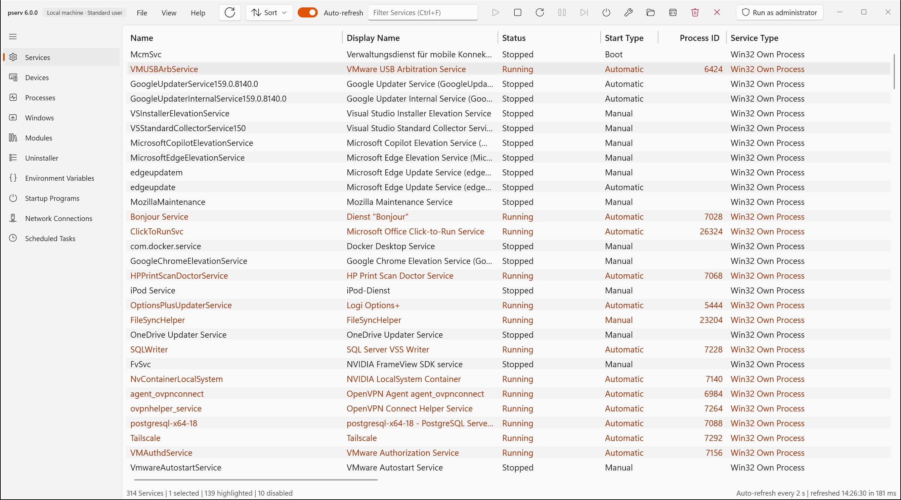
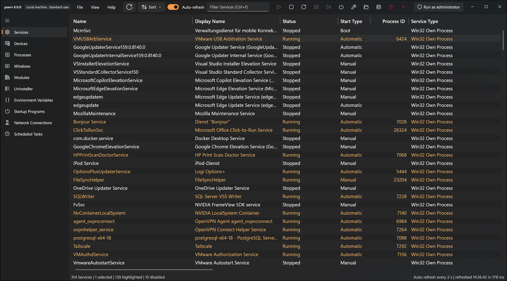
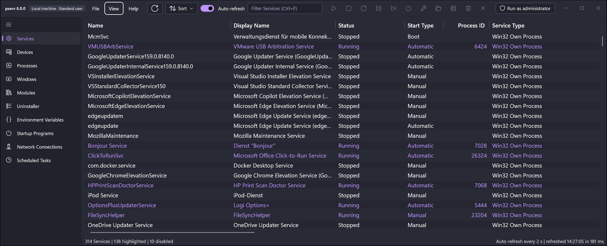
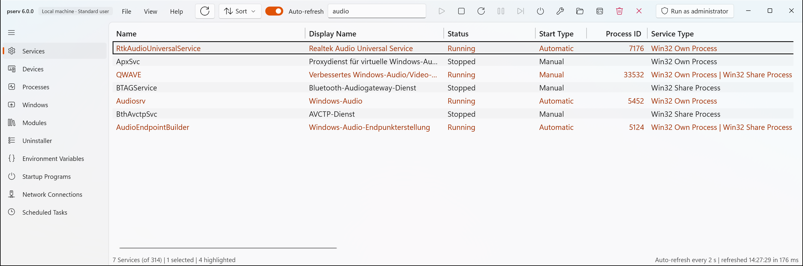
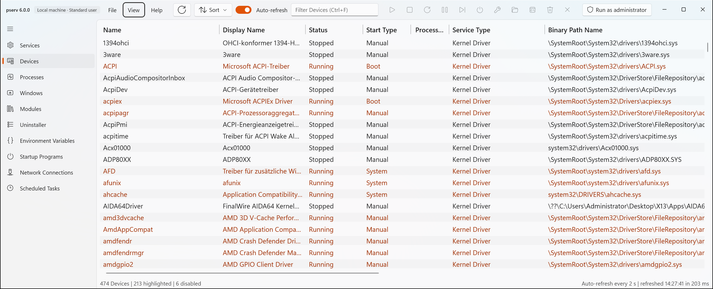

<p align="center">
  
</p>

# pserv 6

A Windows system administration tool: services, devices, processes, windows, modules, installed
programs, environment variables, startup programs, network connections and scheduled tasks in one
window, each as a table you can filter, sort and act on. Native C++ with a WinUI 3 (Fluent)
interface, for x64, x86 and ARM64, plus a command-line companion, `pservc`.



**[Read the manual](https://gersonkurz.github.io/pserv/)** ·
**[Download](https://github.com/gersonkurz/pserv/releases)**

## What it does

| View | Shows | Lets you |
|------|-------|----------|
| **Services** | Windows services with status, start type and configuration | start, stop, restart, pause, change the startup type, edit, uninstall |
| **Devices** | Kernel and file-system drivers | the same as Services |
| **Processes** | Running processes with memory, CPU times and command line | terminate, set the priority, open the file location |
| **Windows** | Top-level windows with class, size and owning process | show, hide, minimize, maximize, close |
| **Modules** | DLLs loaded in the running processes | open the containing folder |
| **Uninstaller** | Installed programs | start the program's uninstaller |
| **Environment Variables** | User and system variables | add, edit, rename, delete |
| **Startup Programs** | Run keys and Startup folders | enable, disable, delete |
| **Network Connections** | TCP connections and TCP/UDP listeners | close a connection, copy endpoints |
| **Scheduled Tasks** | Task Scheduler tasks | run, enable, disable, delete |

Across all views:

- **Instant filter** over every column, sorting by any column, columns you can resize, reorder
  and hide
- **Every action visible** in the toolbar; those the selected rows do not allow are greyed out
- **Properties dialog** for details and editing, also for several rows at once
- **Auto-refresh** in the background, without losing selection or scroll position
- **Copy and export** as tab-separated text, JSON or plain text
- **Remote machines**: services and devices of another computer
- **Starts without administrator rights**; one click restarts it elevated when you need to change
  something
- **Light, dark and 20 Base16 themes**, zoom and a table font of your choice

| | |
|---|---|
|  |  |
|  |  |

## Command line

`pservc` lists, filters, exports and acts from scripts:

```
pservc services --filter spooler
pservc processes --sort "Working Set" --desc --format json
pservc services start Spooler
```

See [pservc in the manual](https://gersonkurz.github.io/pserv/cli.html).

## Installing

Get `pserv6-6.0.0.exe` from the [releases page](https://github.com/gersonkurz/pserv/releases); it
picks the right architecture. The per-architecture MSIs are there too. Windows 10 version 1809 or
later, or Windows 11. Installing pserv 6 replaces an installed pserv 5 and takes over its
settings.

## Building

From a Visual Studio 2026 Developer shell, with [just](https://github.com/casey/just) installed:

```
just build      # Debug, native architecture (x64 or ARM64)
just run        # build and start pserv6
just test       # build and run the core tests
just selftest   # build Release and run the GUI self-test
just release    # Release builds, MSI installers (needs MSIS 3.x) and the bundle
```

`just --list` shows all recipes. The GUI uses the Windows App SDK (NuGet, restored by the build).
Other dependencies are git submodules:

- [spdlog](https://github.com/gabime/spdlog) - logging
- [WIL](https://github.com/microsoft/wil) - Windows Implementation Library
- [toml++](https://github.com/marzer/tomlplusplus) - configuration
- [RapidJSON](https://github.com/Tencent/rapidjson) - JSON export
- [argparse](https://github.com/p-ranav/argparse) - command-line parsing

After checking out a different commit, update them:

```
git submodule update --init --recursive
```

## History

pserv has been around since 1998
([more about its history](https://p-nand-q.com/download/pserv_cpl/index.html)):

| Version | Year | Technology |
|---------|------|------------|
| v1 | 1998 | Custom Windows library |
| v2 | 2002 | MFC |
| v3 | 2010 | C# Windows Forms |
| v4 | 2014 | C# WPF with MahApps.Metro |
| v5 | 2025 | C++20 with ImGui |
| v6 | 2026 | C++ with WinUI 3, co-written with Claude Code |

## License

[MIT](LICENSE)
