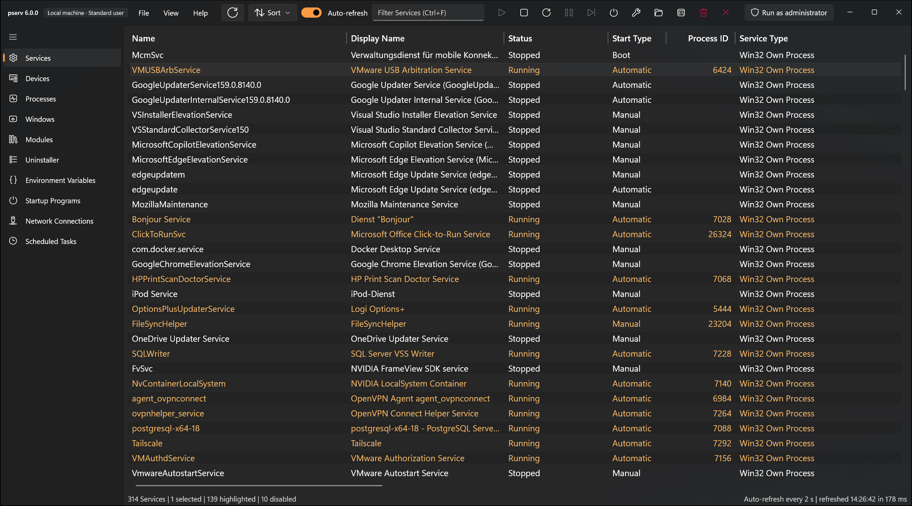
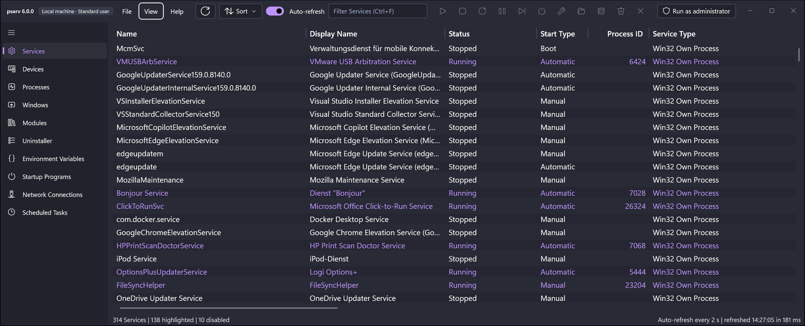
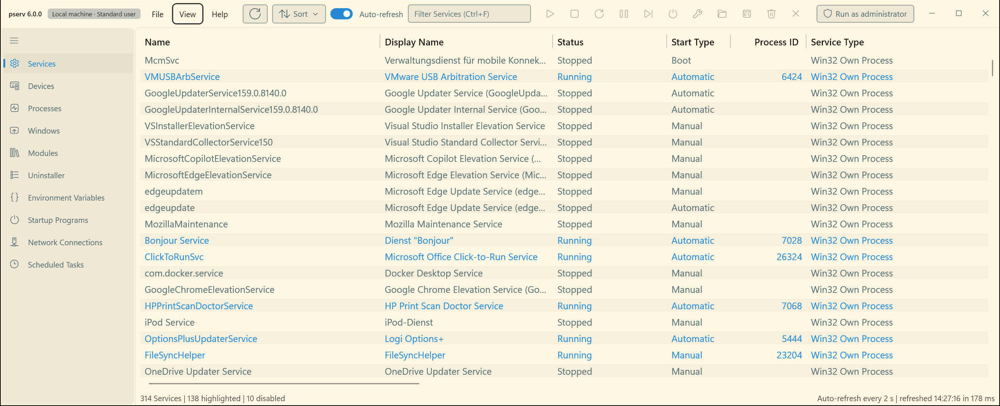

# Appearance

[Back to the contents](index.md)

## Themes

**View > Theme** offers:

- **Use Windows setting** - light or dark, following Windows
- **Light** and **Dark**
- Twenty Base16 colour themes under **Dark themes** and **Light themes**: Catppuccin, Dracula,
  Everforest, Gruvbox, Monokai, Nord, One Dark, One Light, Rose Pine, Solarized, Tokyo Night,
  Tomorrow and their variants

| Dark | Dracula |
|------|---------|
|  |  |

The themes are the `.yaml` files in the `themes` folder next to `pserv6.exe`. Any
[Base16](https://github.com/tinted-theming/home) scheme file copied there appears in the menu at
the next start.

With a Windows high-contrast theme active, pserv uses that instead of its own colours.

## Zoom

The zoom changes the size of the table and its header, from 50 % to 200 %:

- `Ctrl++` and `Ctrl+-`
- `Ctrl` + mouse wheel, anywhere in the window
- **View > Zoom**, which also resets to 100 %

## Table font

**View > Table font > Choose...** opens the Windows font dialog. The family applies to the table
and its header; the size you pick sets the zoom (10.5 pt is 100 %). **Default font** returns to
the Windows font.

A monospaced font such as Cascadia Mono or Consolas lines up paths and hexadecimal values.
