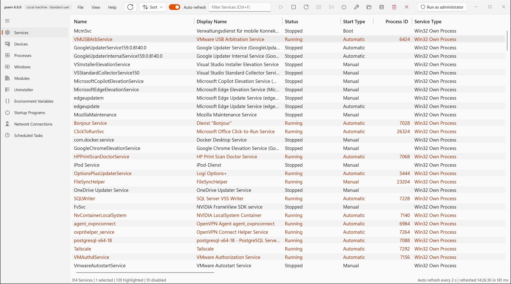

# Getting started

[Back to the contents](index.md)

## Requirements

- Windows 10 version 1809 or later, or Windows 11
- x64, x86 or ARM64

## Installing

Download from the [releases page](https://github.com/gersonkurz/pserv/releases):

| File | Use it when |
|------|-------------|
| `pserv6-6.0.0.exe` | You want one installer that picks the right architecture and installs the Visual C++ runtime if it is missing. |
| `pserv6-6.0.0-x64.msi`, `-x86.msi`, `-arm64.msi` | You deploy a specific architecture yourself. The MSIs need the Microsoft Visual C++ Redistributable to be installed already. |

The installer puts `pserv6.exe` and `pservc.exe` into `Program Files\pserv6`, adds that folder to
`PATH` and creates a Start menu shortcut.

Each MSI has an optional feature **Debug Symbols** (the `.pdb` files). It is not installed unless
you select it in the installer, or pass `ADDLOCAL=ALL` to `msiexec`.

Installing pserv 6 replaces an installed pserv 5. On the first start, pserv 6 imports pserv 5's
settings.

## The window

- **Top row.** The title with a badge that shows which machine you are looking at and with which
  rights; the **File**, **View** and **Help** menus; **Refresh**, **Sort**, the **Auto-refresh**
  switch and the **Filter** box; the actions of the current view as icon buttons; **Run as
  administrator**. The row is also the window's title bar: drag the window by any free spot in it.
  When the window is too narrow for all action buttons, the rest moves into the **...** menu at
  the end of the row.
- **Left.** The ten [views](views.md). The button above them collapses the list to icons.
- **Centre.** The [table](table.md) of the current view.
- **Bottom.** The status bar: how many rows are shown, selected, highlighted and disabled; on the
  right, the auto-refresh state and the time and duration of the last refresh.

## Administrator rights

pserv starts with your own rights. That is enough to look at most things, but Windows refuses
most changes - starting a service, terminating another user's process, editing a system
environment variable - and hides some details.

**Run as administrator** at the right of the top row, or **File > Restart as Administrator**,
restarts pserv elevated. Windows asks for confirmation; if you decline, pserv keeps running as
it was. The badge next to the title then reads "Administrator", and the button disappears.

## Where to go next

- [The views](views.md) lists what each view offers.
- [Working with the table](table.md) explains filtering, sorting and columns.
- [Keyboard](keyboard.md) has every shortcut on one page.
