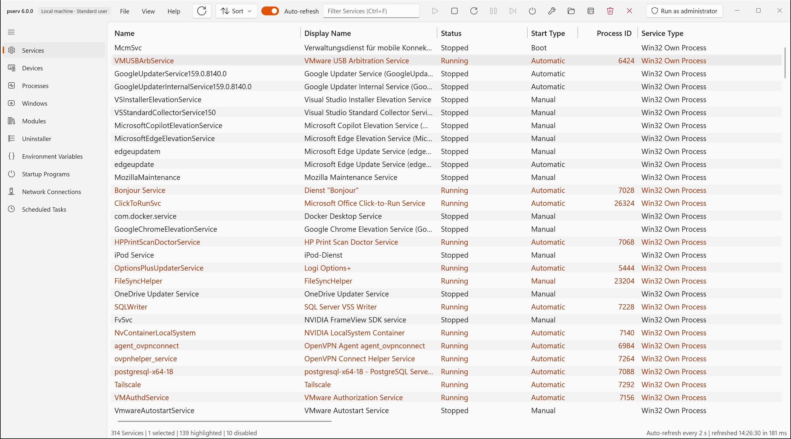

# pserv

pserv is a Windows system administration tool. One window shows the things an administrator
looks at every day - services, devices, processes, windows, loaded modules, installed programs,
environment variables, startup programs, network connections and scheduled tasks - each as a
table you can filter, sort and act on. `pservc` offers the same data and actions on the command
line.

This manual describes pserv 6.0.

## Contents

- [Getting started](getting-started.md) - installing, the window, administrator rights
- [The views](views.md) - what each of the ten views shows and can do
- [Working with the table](table.md) - selecting, filtering, sorting, columns, copying
- [Actions and properties](actions.md) - toolbar, context menu, the Properties dialog
- [Appearance](appearance.md) - themes, zoom and font
- [Remote machines](remote.md) - services and devices of another computer
- [Keyboard](keyboard.md) - all shortcuts
- [Settings and logs](settings.md) - where pserv keeps its state
- [pservc, the command line](cli.md) - listing, exporting and acting from scripts

## Getting pserv

Installers for x64, x86 and ARM64 are on the
[releases page](https://github.com/gersonkurz/pserv/releases). The source code is at
[github.com/gersonkurz/pserv](https://github.com/gersonkurz/pserv), under the MIT license.
