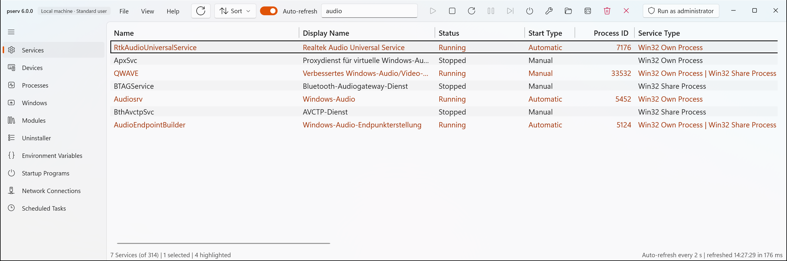

# Working with the table

[Back to the contents](index.md)

## Selecting rows

Click a row, or move with the arrow keys. `Ctrl` and `Shift` extend the selection, as in
Explorer. Actions apply to all selected rows; the status bar shows how many are selected.

## Filtering

Type into the **Filter** box (`Ctrl+F`). The table shows the rows that contain the text in any
column, as you type; upper and lower case do not matter. The status bar shows how many rows match
and how many there are in total. Clear the box to see everything again.

## Sorting

Click a column header to sort by that column; click again to reverse the order. A small triangle
in the header marks the sort column and direction. From the keyboard, the **Sort** button
(`Alt+S`) lists the columns.

Numbers, sizes and dates sort by value, not as text.

## Columns

- **Width:** drag the right edge of a header. Double-click the edge to fit the column to its
  content.
- **Order:** drag a header to another position.
- **Hide and show:** right-click a header, or use **View > Columns**.
- **Reset:** **View > Columns > Reset columns** restores the default widths and order and shows
  every column.

Widths, order, hidden columns and the sort are remembered for each view.

The table scrolls in both directions; the scrollbars sit in tracks of their own at the right and
bottom edge and never cover a row or column.

## Refreshing

- `F5` or the **Refresh** button reloads the current view.
- The **Auto-refresh** switch (`Ctrl+R`) reloads it every 1, 2, 5 or 10 seconds; choose the
  interval under **View > Refresh interval**. Selection and scroll position stay where they are.
- Windows, Modules and Scheduled Tasks are refreshed manually only. There the switch is greyed
  out and the status bar says so.
- A view is reloaded automatically after an action.

## Copying and exporting

- `Ctrl+C` copies the selected rows as tab-separated text with a header line, in the current
  column order - ready to paste into a spreadsheet.
- The context menu of every view ends with **Copy as JSON**, **Export to JSON...**,
  **Copy as Plain Text** and **Export to Plain Text...**.

For exports from scripts, see [pservc](cli.md).
