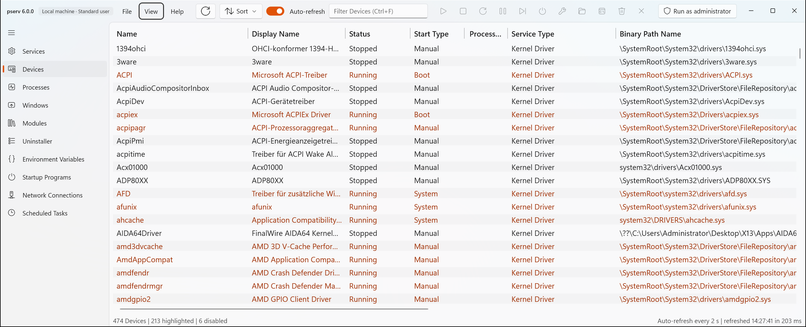

# The views

[Back to the contents](index.md)

Pick a view in the list on the left, from the **View** menu, or with `Ctrl+1` to `Ctrl+9` and
`Ctrl+0` for the tenth. Every view is loaded in the background: the window stays responsive while
data loads or refreshes.

Rows are coloured by state. Running or active items use the accent colour; disabled or
unavailable ones are greyed out.

The actions listed here are in the toolbar and in the context menu of a row; see
[Actions and properties](actions.md). Every view can also copy and export its rows.

## Services

Windows services with status, start type, process ID, account and configuration.

- Start, Stop, Restart, Pause, Resume
- Set Startup: Automatic, Manual or Disabled
- Edit display name, start type, binary path and description in the Properties dialog
- Open in Registry Editor, Open in Explorer, Open Terminal Here
- Uninstall Service, Delete Registry Key
- Can show the services of a [remote machine](remote.md)

## Devices

Kernel and file-system drivers, with the same columns and actions as Services.

## Processes

Running processes with memory, CPU times, handles, priority and command line.

- Terminate Process
- Set Priority
- Open File Location

Without administrator rights, details of other users' processes are missing.

## Windows

Top-level windows with class, size, position, style and owning process.

- Show, Hide, Minimize, Maximize, Restore, Bring To Front, Close

This view is refreshed manually (`F5`); auto-refresh does not apply to it.

## Modules

DLLs and executables loaded in the running processes.

- Open Containing Folder

Refreshed manually. A 32-bit pserv cannot look into 64-bit processes; use the x64 or ARM64 build
on such systems.

## Uninstaller

Installed programs with publisher, version and install date.

- Uninstall (starts the program's own uninstaller)

## Environment Variables

User and system environment variables.

- Add User Variable, Add System Variable
- Edit name and value in the Properties dialog
- Copy Name, Copy Value, Delete
- Open in Registry Editor

Variables that contain references such as `%SystemRoot%` keep their expandable type when you edit
or rename them. System variables need administrator rights.

## Startup Programs

Programs started at sign-in, from the registry Run keys and the Startup folders.

- Enable, Disable (registry entries), Delete
- Copy Command, Copy Name
- Open File Location, Open in Registry Editor

## Network Connections

Active TCP connections and TCP/UDP listeners with their owning process.

- Copy Local Endpoint, Copy Remote Endpoint, Copy Process Name
- Close Connection

## Scheduled Tasks

Tasks of the Windows Task Scheduler with status, trigger and run times.

- Run Now, Enable, Disable, Delete
- Copy Name, Copy Path
- Edit Configuration (opens the Task Scheduler)

Refreshed manually.
