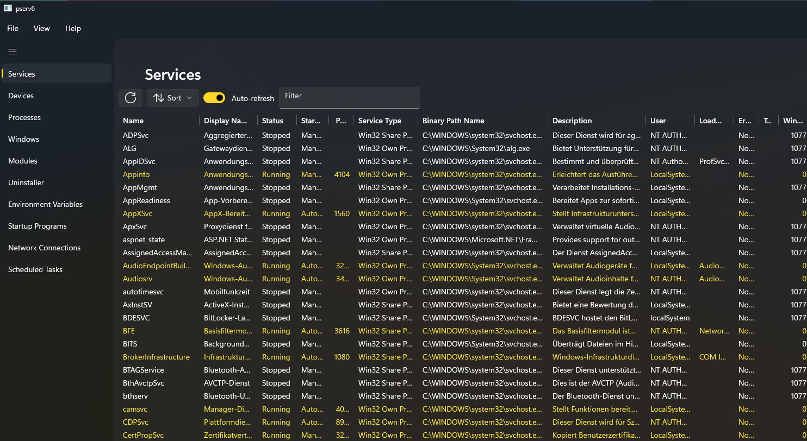

# pserv6 - Graphical User Interface

`pserv6.exe` is the graphical interface of pserv6, a Windows system administration tool. It is a native WinUI 3 application for x64 and ARM64 and requires administrator rights (Windows asks for elevation when it starts).

## Overview

- **Ten views**, selected in the navigation pane on the left or with `Ctrl+1` … `Ctrl+0`
- **Background loading**: every view is enumerated on a worker thread; the window stays responsive while data loads or refreshes
- **Filter** box for instant search across all columns (`Ctrl+F`)
- **Sorting** by clicking a column header, or from the keyboard with the **Sort** button (`Alt+S`)
- **Columns** can be resized (drag the right edge of a header) and reordered (drag a header); widths, order and sort are remembered per view
- **Context menu** with the actions for the selected rows (right-click, `Shift+F10` or the menu key)
- **Properties** dialog for details and editing (double-click or `Enter`)
- **Auto-refresh** with an interval of 1, 2, 5 or 10 seconds
- **Copy and export** of the selected rows as tab-separated text, JSON or plain text
- **Light and dark theme**, following Windows or chosen in the View menu
- **Zoom** for the table, 50 % to 200 %

Rows are coloured by state: running or active items use the Windows accent colour, disabled or unavailable ones are greyed out.

## Views

### Services

Windows services with status, start type and configuration.
- Start, Stop, Restart, Pause, Resume
- Set Startup: Automatic / Manual / Disabled
- Edit display name, start type, binary path and description in the Properties dialog
- Open in Registry Editor, Open in Explorer, Open Terminal Here
- Uninstall Service, Delete Registry Key
- Can show the services of a [remote machine](#remote-machine-access)

### Devices

Kernel and file-system drivers, with the same columns and actions as Services.

### Processes

Running processes with memory, CPU times, handles and command line.
- Terminate Process
- Open File Location

### Windows

Top-level windows with class, size, style and owning process.
- Show, Hide, Minimize, Maximize, Restore, Bring To Front, Close

### Modules

DLLs and executables loaded in the running processes.
- Open Containing Folder

### Uninstaller

Installed programs with publisher, version and install date.
- Uninstall (starts the program's own uninstaller)

### Environment Variables

User and system environment variables.
- Add User Variable / Add System Variable
- Edit name and value in the Properties dialog
- Copy Name, Copy Value, Delete
- Open in Registry Editor

### Startup Programs

Programs started at sign-in, from the registry Run keys and the Startup folders.
- Enable, Disable (registry entries), Delete
- Copy Command, Copy Name
- Open File Location, Open in Registry Editor

### Network Connections

Active TCP connections and TCP/UDP listeners with their owning process.
- Copy Local Endpoint, Copy Remote Endpoint, Copy Process Name
- Close Connection

### Scheduled Tasks

Tasks of the Windows Task Scheduler with status, trigger and run times.
- Run Now, Enable, Disable, Delete
- Copy Name, Copy Path
- Edit Configuration (opens the Task Scheduler)

## Working with rows

- **Select** rows with the mouse or keyboard; `Ctrl` and `Shift` extend the selection.
- **Actions** in the context menu apply to all selected rows; the menu shows the count. Destructive actions are shown in red and ask for confirmation, with **No** as the default button.
- Long-running actions (for example stopping a service) show a progress dialog with **Cancel**.
- Every view's context menu ends with **Copy as JSON**, **Export to JSON...**, **Copy as Plain Text** and **Export to Plain Text...**.
- `Ctrl+C` copies the selected rows as tab-separated text with a header line, in the current column order — ready to paste into a spreadsheet.
- The view refreshes automatically after an action.

## Properties dialog

Double-click a row or press `Enter`. The dialog lists every column of the item. Editable fields (their labels are bold) are text boxes, number boxes or drop-down lists; **OK** applies the changes, **Cancel** discards them. With several rows selected, a picker at the top switches between the items, and OK applies the edits of all of them.

The item's actions are available as buttons below the fields. They are disabled while there are unsaved edits.

## Keyboard shortcuts

| Shortcut | Action |
|----------|--------|
| `Ctrl+1` … `Ctrl+9`, `Ctrl+0` | Switch to view 1 … 10 |
| `F5` | Refresh the current view |
| `Ctrl+R` | Turn auto-refresh on or off |
| `Ctrl+F` | Go to the filter box |
| `Alt+S` | Open the Sort menu |
| `Enter` or double-click | Properties of the selected rows |
| `Shift+F10` or menu key | Context menu |
| `Delete` | The view's Delete action for the selected rows (with confirmation) |
| `Ctrl+C` | Copy the selected rows |
| `Ctrl++` / `Ctrl+-` | Zoom in / out (also `Ctrl` + mouse wheel over the table) |
| `Alt+F`, `Alt+V`, `Alt+H` | File, View and Help menus |

## Menu reference

### File

- **Refresh** (`F5`)
- **Connect to Remote Machine...** / **Connect to Local Machine** — see below
- **Exit**

### View

- The ten views
- **Auto-refresh** (`Ctrl+R`) and **Refresh interval** (1, 2, 5, 10 seconds). Windows, Modules and Scheduled Tasks are refreshed manually only.
- **Theme**: Use Windows setting, Light, Dark
- **Zoom**: Zoom in, Zoom out, Reset to 100 %

### Help

- **Documentation** — opens this manual
- **About pserv6...** — version, build, whether pserv6 runs as administrator, and where its settings are

## Remote machine access

**File > Connect to Remote Machine...** shows the Services and Devices of another computer. Enter its name or IP address; pserv6 tests the connection before switching. While connected, the other views are unavailable and the window title shows the machine. **File > Connect to Local Machine** returns to this computer. The last machine is remembered.

Actions and edits apply to the machine the rows come from: Start, Stop, Restart, Pause, Resume, the startup type, Uninstall Service and edits in the Properties dialog work on the remote machine's services. Actions that need this computer — Open in Registry Editor, Open in Explorer, Open Terminal Here and Delete Registry Key — are not offered for remote rows.

Requirements: administrative rights on the target, and network access to its service control manager.

## Settings and logs

pserv6 keeps its settings in `%APPDATA%\pserv6\config.toml`:
- window position and size
- the active view, theme and zoom
- column widths, column order and sort per view
- auto-refresh and its interval
- the last remote machine

On the first start, the settings of an installed pserv5 are imported (except its font size and colour theme). The log files `pserv6.log` and `pservc.log` are written to the same folder.

## Self-test

`pserv6.exe --selftest [View,View,...] [--seconds N] [--log file]` loads, scrolls and refreshes every view and writes a timing log; `--selftest-actions` runs the views' actions against throwaway objects it creates itself. Both leave the settings untouched. They are meant for development (`just selftest`).

## Command line companion

For scripting and automation, use `pservc.exe` — see the [pservc documentation](pservc.md).
